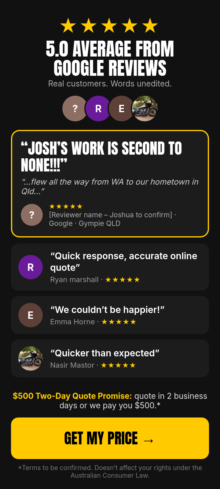
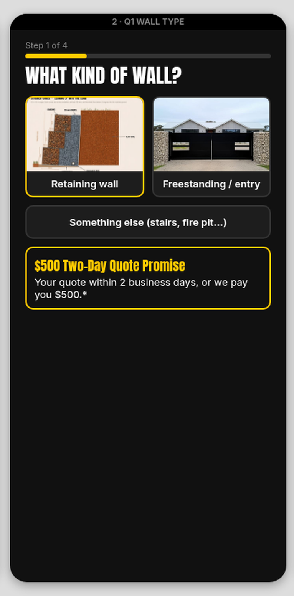
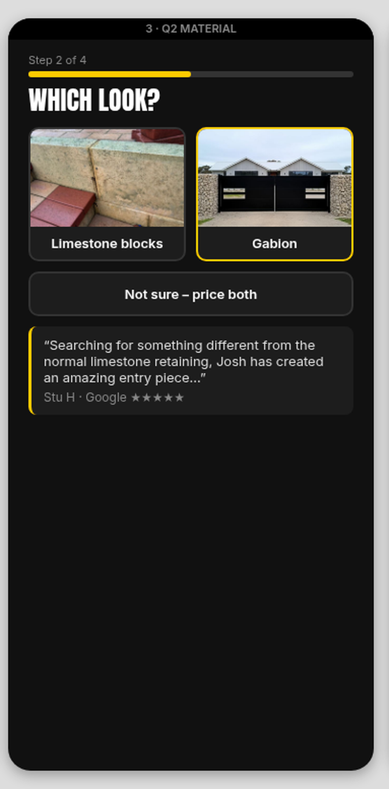
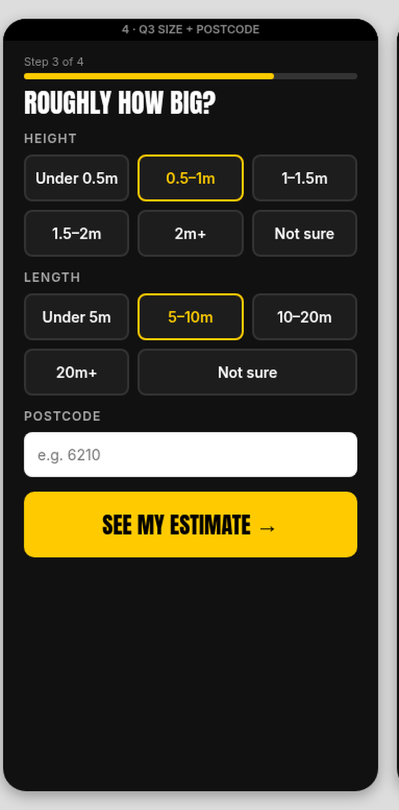
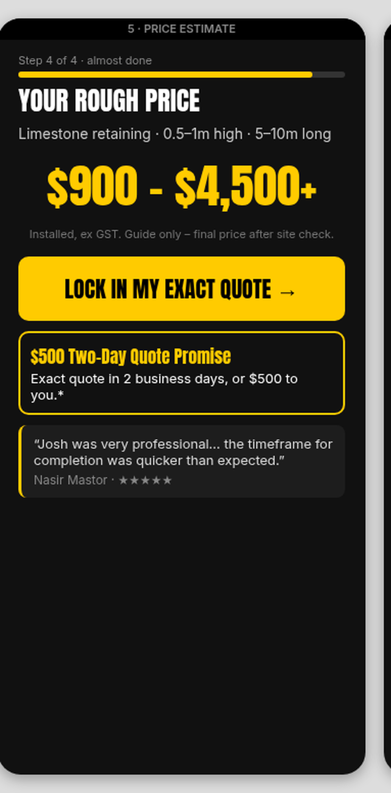
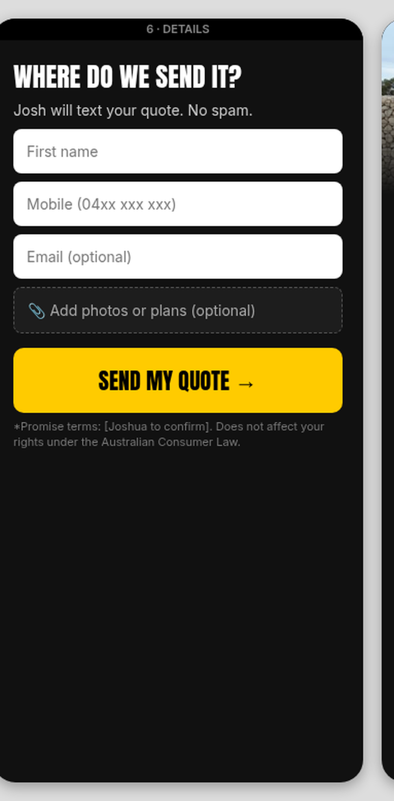
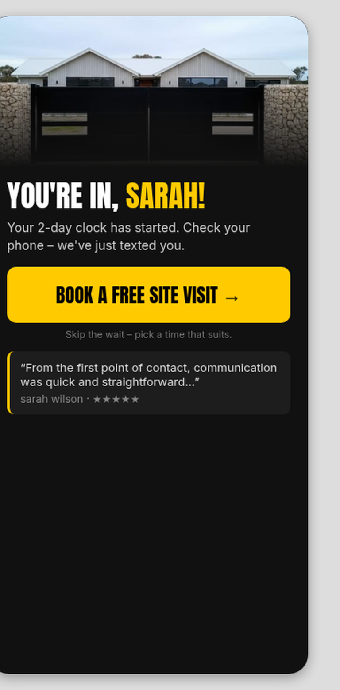

# Wall Quote Quiz: showstopper plan (7 screens)

Gabion Fabrication, WA. Mobile-first, dark background, Anton headlines, Inter body, one yellow (#FFCB00) button per screen, one message per screen. Draft plan only, not live.

## Screen 1: Welcome (reviews are the hero)

Source mockup: `screen1.html` (360×800, rendered at 2x).

- Top: big **★★★★★ 5.0 average from Google reviews**. Under it: "Real customers. Words unedited."
- A row of reviewer avatars.
- **Lead testimonial (yellow-bordered card):** "Josh's work is second to none!!!", with the excerpt "…flew all the way from WA to our hometown in Qld…" under it.
  - The reviewer is the Gympie (QLD) customer. **Her name and photo still need confirming with Joshua**: aggregator sites show the text but not her name.
- 3 snippet cards. Each has the reviewer's face or initials, their name and 5 stars:
  - "Quick response, accurate online quote" (Ryan marshall)
  - "We couldn't be happier!" (Emma Horne)
  - "Quicker than expected" (Nasir Mastor)
- One smaller line: **$500 Two-Day Quote Promise:** quote in 2 business days or we pay you $500.*
- Yellow #FFCB00 button: **GET MY PRICE →**
- Fine print: *Terms to be confirmed. Doesn't affect your rights under the Australian Consumer Law.

**Rules for review snippets (Australian Consumer Law, fake reviews):**
- Every snippet is a word-for-word excerpt from that person's real 5★ review.
- Don't rewrite them.
- Don't use the review posted under the owner's name (Joshua Cappello).

**Avatars:**
- Nasir Mastor's avatar is his real Google profile photo, via Trustindex.
- The others have Google letter avatars, so they're shown as initials circles.
- No stock faces.

## Screen 2: What kind of wall?

- Progress bar: Step 1 of 4
- Photo cards: Retaining / Freestanding & entry
- Full-width bar: Something else (stairs, fire pit…). Skips straight to Details.
- $500 promise box at the bottom.

## Screen 3: Which look?

- Photo cards: Limestone / Gabion
- Bar: Not sure, price both
- Review: "Searching for something different from the normal limestone retaining, Josh has created an amazing entry piece to both our block and our house." (Stu H)

## Screen 4: Roughly how big?

- Height tiles from under 0.5 m to 2 m+, plus Not sure.
- Length tiles from under 5 m to 20 m+, plus Not sure.
- Postcode field.
- Button: **SEE MY ESTIMATE →**

## Screen 5: Your rough price

- Shows a range, e.g. $900 – $4,500+ (installed, ex GST, guide only).
- Button: **LOCK IN MY EXACT QUOTE →**
- $500 promise box.
- Review: "Josh was very professional and completed all works without an issue. The wall looks great and the timeframe for completion was quicker than expected." (Nasir Mastor)

## Screen 6: Where do we send it?

- Required: first name and mobile.
- Optional: email, project description, and an upload for site plans or photos.
- Button: **SEND MY QUOTE →**
- Promise fine print below.

## Screen 7: Thank you

- Headline: **YOU'RE IN, [NAME]!** Your 2-day clock has started.
- Button: **BOOK A FREE SITE VISIT →**
- Review: "From the first point of contact, communication was quick and straightforward and his knowledge of the product was outstanding." (sarah wilson)
- Instant SMS: "Hi [name], Josh here, got your [limestone] wall request. Your quote's on its way within 2 business days. Want to jump the queue? Book a site visit: [link]". Josh is alerted at the same time.

## Still to confirm
- The exact $500 promise terms: business or calendar days, cash or credit, and what counts as a complete enquiry. These need to be shown beside the promise.
- A clean finished limestone photo and a retaining wall job photo.
- Sign-off on the price ranges.
